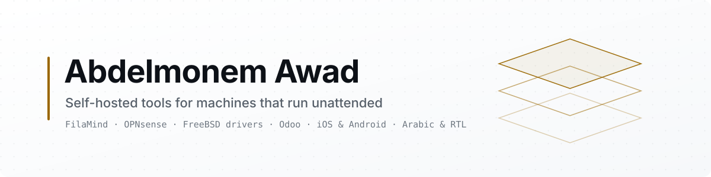
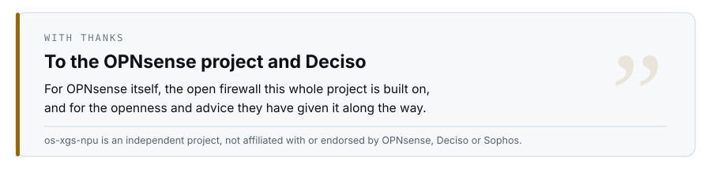
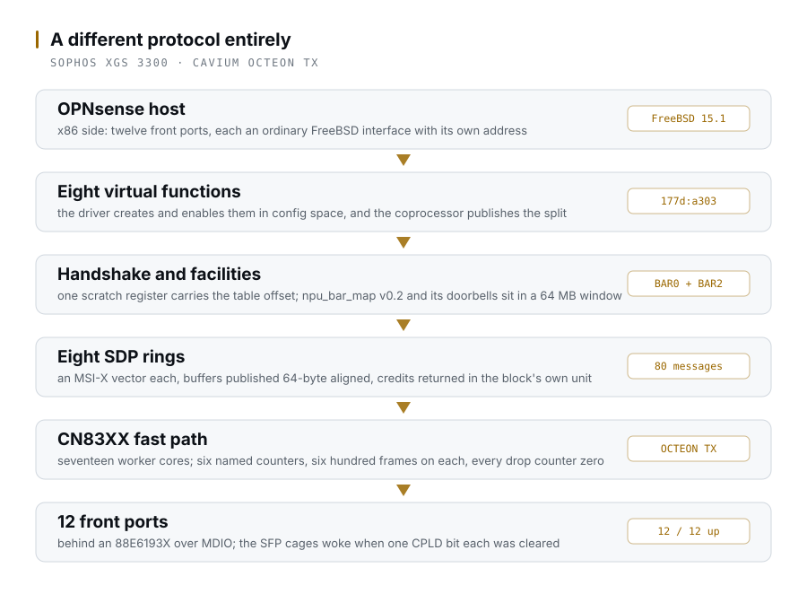
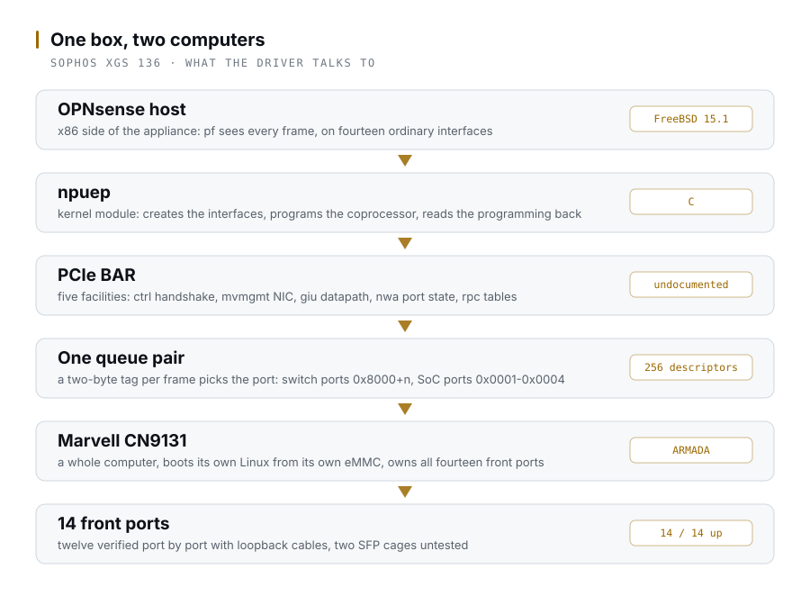
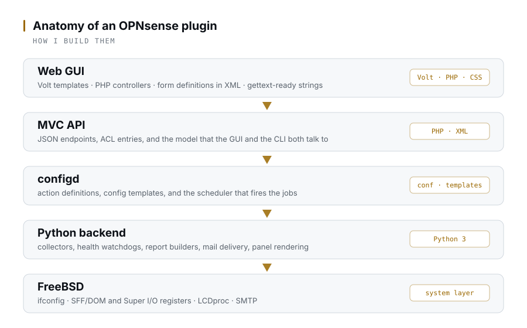

<picture>
  <source media="(prefers-color-scheme: dark)" srcset="assets/banner-dark.svg">
  <source media="(prefers-color-scheme: light)" srcset="assets/banner-light.svg">
  
</picture>

Hi, I'm Abdelmonem. I build self-hosted software for hardware that is supposed to look after itself — and, lately, drivers for hardware that refuses to be driven at all. Alongside that: a control suite for Klipper 3D printers, plugins for OPNsense firewalls, local LLM serving on Synology hardware, Odoo modules, and iOS and Android apps.

Most of it is Python, TypeScript and C. Almost all of it ships in Arabic as well as English, because the people running this hardware do not all read English.

## os-xgs-npu — reclaiming a family of firewalls

<picture>
  <source media="(prefers-color-scheme: dark)" srcset="assets/thanks-dark.svg">
  <source media="(prefers-color-scheme: light)" srcset="assets/thanks-light.svg">
  
</picture>

Install OPNsense on a Sophos XGS and it boots to a working firewall with **no network interfaces at all**. The appliance is two computers, and the second — a coprocessor behind PCIe, with drivers for Linux and the vendor's own OS only — owns every front port, so when support lapses the usual verdict is e-waste. **[os-xgs-npu](https://github.com/AbdelmonemAwad/os-xgs-npu)** is the FreeBSD kernel modules that hand those ports back, written against registers no vendor documents, across a family of six coprocessor generations.

I gave it a home of its own, **[npuforge.org](https://npuforge.org)**: the guide, every measurement with its method, a compatibility list that owners add to, a page for every model and expansion module, news of each release and the story, in English and [in Arabic](https://npuforge.org/ar/), with its main pages in six more languages.

> **The repository is much younger than the work in it.** It went public on 25 September 2026; the work
> behind it took close to two years — eight months of surveying other vendors' appliances, adapters that
> failed, a firmware of my own that ran into a board of many chips, and then the turn every driver here
> stands on: the host learning to speak the coprocessor's own language.
> **[The whole story is on the site.](https://npuforge.org/story/)**

<picture>
  <source media="(prefers-color-scheme: dark)" srcset="https://npuforge.org/readme/status-dark.svg">
  <source media="(prefers-color-scheme: light)" srcset="https://npuforge.org/readme/status-light.svg">
  
</picture>

- **Two unrelated coprocessors, one contract.** Marvell and Cavium silicon answer the same kernel offload interface, behind the same OPNsense pages, and both drivers take the same orders: hand one connection back to the host, never offload these addresses or ports.
- **The tunnel costs nothing.** With hardware at both ends, IPsec runs at the rate of clear text — 1.85 Gbit/s on one stream at the standard MTU, 7.41 Gbit/s with jumbo frames. Both engines carry IPv6 outside the tunnel and inside it, and extended sequence numbers, both ways - the XGS 136's at its gigabit's rate. On both appliances a connection's outgoing side can be encrypted and forwarded by the coprocessor alone, without one of its frames passing through the host. Sixteen tunnels at once between two XGS 3300s carried 9,019 Mbit/s from one 10G port, and six through the XGS 136 carried 915; two hours of TLS through the 136's engine, 756 GiB, arrived without a byte changed.
- **Forwarded at the link's rate.** IPv6 connections handed to the coprocessor carry 9.27 Gbit/s through an XGS 3300 on eight streams, every one of them in hardware — the 10G link is the limit, not the chip. A thousand connections at once fill it too: 9,837 Mbit/s with the host's processors 7.8 % busy. The XGS 136 does the same at its gigabit, for IPv6 and for IPv4 translated from LAN to WAN in the coprocessor: 941 Mbit/s with its processors 0.4 % busy, against 19.6 % through the host.
- **What the offload buys is the processor.** Most of a core at a gigabit, against a few hundredths of one, with 99.6 per cent of a connection's frames in hardware.
- **Fast, and still a firewall.** A connection the coprocessor forwards can still be cut: when a block list gains its address, or when OPNsense's intrusion detection sees its TLS fingerprint (JA4) on a list - and the coprocessor drops it there and then, so a sender that keeps going never reaches the host: a 400 Mbit/s UDP flood cut on an XGS 3300 sent the host [10 frames in ten seconds](https://github.com/AbdelmonemAwad/os-xgs-npu/blob/main/docs/measurements/verdict-2026-10-23.md), against 610,533 when the connection was handed back. Every segment is held to its connection's TCP window in hardware too, from pf's own numbers, and keeps the DSCP mark a normalization rule gives it. A connection a LAN bridge carries, and one routed by a VLAN subinterface, go into hardware as well - on the XGS 136 every VLAN's frames used to cross the host with its processors 32 to 39 % busy, against 0.9 to 1.7 % [now](https://github.com/AbdelmonemAwad/os-xgs-npu/blob/main/docs/measurements/vlan-2026-10-24.md). And intrusion prevention no longer has to give up the offload: with Inspect, then hardware, OPNsense's own Suricata in IPS mode sees each new connection's first megabyte before the coprocessor carries the rest - a stream it alerted on then ran at [3.98 Gbit/s on an XGS 3300](https://github.com/AbdelmonemAwad/os-xgs-npu/blob/main/docs/measurements/inspect-2026-10-23.md), and one its drop rule named never got through. When an IPsec policy comes to cover it, it leaves the hardware for the tunnel, so nothing meant for the tunnel goes out in the clear. It is still counted: the coprocessor's own figures reach pf's states and rules and the interfaces' traffic graphs, which would otherwise never see it. And a port scan, a sweep, or a host far beyond its own normal is reported, never blocked. Each of these is measured on both appliances. What the Traffic Shaper names stays with the host too, so a shaper's pipe still holds — measured on the XGS 3300. The Captive Portal's clients can run in hardware instead: a logout or a timeout still ends them at once, and the coprocessor's counts reach the portal, so its idle timeout and RADIUS accounting see what the hardware carried — [measured on both appliances](https://github.com/AbdelmonemAwad/os-xgs-npu/blob/main/docs/measurements/cp-hardware-2026-10-24.md).
- **Two roads onto an appliance.** Most people start from a bootable image, and since 0.1.0-alpha.5.6 they can simply [download one](https://build.npuforge.org): **[xgs-image-builder](https://github.com/AbdelmonemAwad/xgs-image-builder)** publishes ready-made images with every release, with checksums beside them, and still builds one to order from the same page in the browser, in English or Arabic. Either way the newest release, the plugins, Arabic and right-to-left are already inside, and images built that way are installed on an XGS 3300 and an XGS 136 - the 136's took an OPNsense update from its own GUI, its driver rebuilt for the new kernel with nothing done by hand. Experts can load the drivers by hand; for everyone else I wrote [a guide from nothing to the first sign-in](https://npuforge.org/docs/guide/step-by-step/), a picture for each step, in English and [Arabic](https://npuforge.org/ar/guide/step-by-step/). Either way it lives in OPNsense as if it belonged there — a menu section of its own, from the overview and the ports to updates and problem reports, in Arabic and English; ports assigned by the names on the chassis at the first boot; and updates from tagged releases since **[0.1.0-alpha.1](https://github.com/AbdelmonemAwad/os-xgs-npu/releases/tag/v0.1.0-alpha.1)**, installed from its own page: the three appliances here took [0.1.0-alpha.2](https://github.com/AbdelmonemAwad/os-xgs-npu/releases/tag/v0.1.0-alpha.2) that way. It watches its own coprocessor as well: the host asks the fast path every five seconds, says so when it stops answering, and restarts the appliance if its owner chose that. And no problem report and no count leaves an appliance unless its owner says so: reports wait to be sent and the count stays off until it is turned on, the default I set after the first people to read about the project asked for it.
- **It keeps its own score.** The main part is done and the rest arrives as updates, but it is an alpha and says so: every figure with its method in [the measurements](https://github.com/AbdelmonemAwad/os-xgs-npu/tree/main/docs/measurements), the dead ends on [the road](https://github.com/AbdelmonemAwad/os-xgs-npu/blob/main/docs/the-road.md), and plain advice to try a release first on an appliance you can reach. Every other model of both families installs too - the XGS 87, 107, 116, 126 and 138, the XGS 2100, 2300 and 3100 - marked untested until one has been on the bench, and checks its own ports against its coprocessor at the first boot. Owners run it now as well: an XGS 126 runs for two of them, and the second's coprocessor, last run under SFOS 23, taught [both drivers](https://github.com/AbdelmonemAwad/os-xgs-npu/pull/749) to tell which Sophos release left its software there - 21, 22 or 23 - and to number their commands to match. And when a sweep of the vendor's sources found [29 things this hardware can do that were not known](https://github.com/AbdelmonemAwad/os-xgs-npu/blob/main/docs/findings/discoveries-2026-10-22.md), the completion figures went down to count them. Ten of them are [built and measured already](https://github.com/AbdelmonemAwad/os-xgs-npu/blob/main/docs/findings/discoveries-2026-10-22.md), and three more were measured and found out of reach with this firmware.

How each family is driven

 

<picture>
  <source media="(prefers-color-scheme: dark)" srcset="assets/octeon-dark.svg">
  <source media="(prefers-color-scheme: light)" srcset="assets/octeon-light.svg">
  
</picture>

<picture>
  <source media="(prefers-color-scheme: dark)" srcset="assets/npu-dark.svg">
  <source media="(prefers-color-scheme: light)" srcset="assets/npu-light.svg">
  
</picture>

## FilaMind — Klipper and Moonraker

[FilaMind](https://github.com/filamind-app) is an open-source, self-hosted suite for makers running Klipper and Moonraker. Most of my commits over the past year went here.

- **[filamind-core](https://github.com/filamind-app/filamind-core)** — the TypeScript foundation the rest is built on: a Moonraker client, a session orchestrator, a fail-closed write arbiter so two front ends can never fight over the same printer, and i18n for 19 locales.
- **[filamind-flow](https://github.com/filamind-app/filamind-flow)** — the control panel: firmware flashing, input shaping, TMC motor-driver tooling. Python and FastAPI behind Vue 3, built one widget at a time so each piece can be adopted on its own.
- **[filamind-screen](https://github.com/filamind-app/filamind-screen)** — the on-printer touch interface, same core, wrapped as a desktop app with Tauri 2.
- **[filamind-3d](https://github.com/filamind-app/filamind-3d)** — the web control UI on top of the core. Vue 3, Vite and Tailwind over a lean FastAPI host.
- **[filamind-ai](https://github.com/filamind-app/filamind-ai)** — private AI for a Synology NAS: local LLM chat with optional cloud fallback, multi-user, an OpenAI-compatible API, and a full interface in both Arabic and English. Runs on a DVA 3221 with its CUDA GPU, or a DS1821+ on CPU.
- **[filamind-setup](https://github.com/filamind-app/filamind-setup)** — one installer engine behind two front ends, a CLI and a widget inside flow.

## OPNsense plugins

Five plugins, BSD-2 licensed like the platform itself and packaged as FreeBSD ports.

- **[os-linkhealth](https://github.com/AbdelmonemAwad/os-linkhealth)** — watches every physical port and names the cable or transceiver that is going bad, by the label printed on the chassis rather than the interface name. It reads the DOM registers on the transceivers, so the warning arrives before the link actually drops.
- **[os-netreport](https://github.com/AbdelmonemAwad/os-netreport)** — scheduled network reports by email, and an alert the first time an unknown device shows up. Each report is written in whichever language the GUI is set to.
- **[os-frontpanel](https://github.com/AbdelmonemAwad/os-frontpanel)** — drives the LCD and buttons built into an appliance's front panel through LCDproc, with the screens and their timing set from the GUI instead of a config file on disk.
- **[os-fanctl](https://github.com/AbdelmonemAwad/os-fanctl)** — fan control and every readable temperature sensor, for repurposed appliances whose fan curve left with the vendor firmware. Talks to the Super I/O chip directly.
- **[os-theme-xgs](https://github.com/AbdelmonemAwad/os-theme-xgs)** — XGS Silicon, a light, a dark and an automatic theme for the OPNsense GUI on the XGS appliances: carbon and copper like the hardware, IBM Plex with its own Arabic, and not one page's layout changed. An image built for the XGS starts with it.

Three of them now know the Sophos XGS appliances above — port labels for every XGS board and FleXi module, generated from the vendor's own board files, port identification through the coprocessor, temperature and fan readings from the board and from the coprocessor, the 3300's front panel with its buttons and a menu — so a reclaimed box gets more back than its ports. Six packages — the first four here, and the Arabic and right-to-left ones — update only when their owner says so: on an XGS from one Plugins tab in XGS: Updates, anywhere else by hand. All six survive an OPNsense update that replaces their strings or templates.

Six more are planned, each opened as a repository of its own and empty until its code lands: [a kernel follower](https://github.com/AbdelmonemAwad/os-kernelfollow), [a hardware watchdog](https://github.com/AbdelmonemAwad/os-watchdog), [fallback crypto](https://github.com/AbdelmonemAwad/os-fallbackcrypto) for the tunnels the coprocessor does not take, [block lists](https://github.com/AbdelmonemAwad/os-blocklists) cut in hardware, [traffic priority](https://github.com/AbdelmonemAwad/os-trafficpriority) in the coprocessor's queues, and [Layer 2 port rules](https://github.com/AbdelmonemAwad/os-portguard).

They share one shape:

<picture>
  <source media="(prefers-color-scheme: dark)" srcset="assets/stack-dark.svg">
  <source media="(prefers-color-scheme: light)" srcset="assets/stack-light.svg">
  
</picture>

Volt templates and PHP for the interface, the model in XML, configd actions in the middle, and Python doing the real work against FreeBSD. Following that layout instead of inventing my own is what lets the plugins get backed up, upgraded and translated like every other part of the system.

## Odoo

Most of my Odoo work is client projects in private repositories: custom modules and business integrations. The public part is the device side, where Odoo has to talk to real hardware.

- **[filamind-iot](https://github.com/deltafabs/filamind-iot)** — a self-hosted IoT gateway addon for Odoo 19, paired with the IoT-box image below.
- **[filamind-iotbox](https://github.com/deltafabs/filamind-iotbox)** — a patched Odoo IoT Box image that takes a server URL directly on its settings page, instead of going through the hosted pairing service.
- **[filamind-iot-proxy](https://github.com/deltafabs/filamind-iot-proxy)** — the replacement for that hosted service: pairing rendezvous, ACME certificate issuer and reverse-tunnel relay, LGPL and running on your own machine.

## Arabic and right-to-left

- **[opnsense-arabic](https://github.com/AbdelmonemAwad/opnsense-arabic)** — the Arabic translation of the OPNsense 26.7 web interface, tracked against upstream so the strings don't drift between releases. It carries the XGS plugins' Arabic too: 1,254 strings in the same catalogue.
- **[opnsense-rtl](https://github.com/AbdelmonemAwad/opnsense-rtl)** — right-to-left layout for Arabic and Persian. Flipping the text direction is the easy half; tables, form flow, icon direction, menu alignment and a long tail of Bootstrap overrides are what decide whether an RTL interface is genuinely usable or merely mirrored.

The same concern runs through everything else: 19 locales in filamind-core, Arabic and English throughout filamind-ai, every OPNsense report rendered in the language of whoever has to read it, and every page the XGS driver and the plugins add to OPNsense translated into Arabic with the rest — [each one photographed in both languages](https://npuforge.org/docs/guide/the-pages/). And I built the XGS project's site [an Arabic edition](https://npuforge.org/ar/) of its own, right to left, with Arabic menus and search.

## cadenza

**[cadenza](https://github.com/AbdelmonemAwad/cadenza)** curates music libraries on a Synology NAS: acoustic fingerprinting to find real duplicates, metadata pulled from several sources, format conversion. It never deletes anything. Suspect files go to quarantine, because a false positive should cost you a folder, not a recording. DSM 7, x86_64.

## Not on this page

A fair amount of my work stays in private repositories: the Odoo projects built on top of the modules above, and iOS and Android applications. Ask if that is the part you need.

## What I use

Python for backends, plugins and media pipelines. C for the kernel side — the XGS drivers above all, then the Super I/O access in the fan controller and the local inference build in filamind-ai. TypeScript and Vue 3 for every FilaMind front end, React on cadenza. PHP and Volt because that is what an OPNsense interface is written in, and SCSS for its theme. Rust where a Tauri shell needs it.

Underneath: FreeBSD and its ports tree, Synology DSM 7, Docker, FastAPI, Vite, Tailwind, gettext, and GitHub Actions for CI and releases. At the hardware end: PCIe network coprocessors, SFP/SFF DOM registers, HD44780 panels through LCDproc, TMC stepper drivers, and CUDA when there is a GPU worth using.

Happy to talk about Klipper tooling, OPNsense plugins, FreeBSD, local LLM serving, or Arabic localization of infrastructure software. Questions about the XGS drivers are best asked in [the project's Discussions](https://github.com/AbdelmonemAwad/os-xgs-npu/discussions), where the answer stays for the next person.

If the XGS work is useful to you, **[sponsoring it](https://github.com/sponsors/AbdelmonemAwad)** pays for the appliances, modules and test gear the next families need. So far all of it has come out of my own pocket.

## Recently merged

<!-- merged starts -->
- [npuep: a connection given back is revived every time, as on the XGS 3300 (issue 717)](https://github.com/AbdelmonemAwad/os-xgs-npu/pull/726) — **os-xgs-npu**, 24 Oct
- [Flows: a connection routed by a VLAN subinterface made in hardware (discovery 10)](https://github.com/AbdelmonemAwad/os-xgs-npu/pull/725) — **os-xgs-npu**, 24 Oct
- [os-xgs-npu: VLAN connections - the mark on XGS: Flows and what it means](https://github.com/AbdelmonemAwad/opnsense-arabic/pull/28) — **opnsense-arabic**, 24 Oct
- [security: Pillow 13, cryptography 50, h11 0.16, python-multipart 0.0.31, on manylinux_2_28 wheels](https://github.com/AbdelmonemAwad/cadenza/pull/101) — **cadenza**, 24 Oct
- [Release 1.0.3](https://github.com/AbdelmonemAwad/os-linkhealth/pull/41) — **os-linkhealth**, 24 Oct
- [The string check reads the installed Arabic catalogue before the network](https://github.com/AbdelmonemAwad/os-linkhealth/pull/40) — **os-linkhealth**, 24 Oct
<!-- merged ends -->
